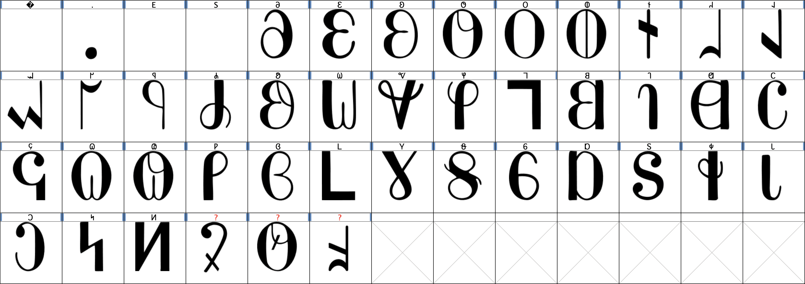
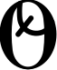

# IDC Hesperapis

A Deseret Alphabet font reproducing the 1868–69 Russell Bros. typeface used in the [Deseret First Book](https://archive.org/details/thedeseretfirstb00unse), [Deseret Second Book](https://archive.org/details/thedeseretsecond02univ), and [The Book of Mormon (1869 ed.)](https://archive.org/details/bookofmormdeseretalpha00/page/n1/mode/2up).

Produced under the auspices of the [Illinois Deseret Consortium](http://faculty.las.illinois.edu/rshosted/deseret.html).  Utilized in [*The Deseret Alphabet: A Fixed and Unalterable Sound*](https://www.press.uillinois.edu/books/?id=p089428).



## Characters

The Deseret alphabet is encoded from U+10400–U+1044F in Unicode.  This font supplies the 40-letter Deseret Alphabet characters at the standard codepoints.

| Codepoint | Letter | Name |
| --- | --- | --- |
| U+10400 | 𐐀 | Deseret Capital Letter Long I |
| U+10401 | 𐐁 | Deseret Capital Letter Long E |
| U+10402 | 𐐂 | Deseret Capital Letter Long A |
| U+10403 | 𐐃 | Deseret Capital Letter Long Ah |
| U+10404 | 𐐄 | Deseret Capital Letter Long O |
| U+10405 | 𐐅 | Deseret Capital Letter Long Oo |
| U+10406 | 𐐆 | Deseret Capital Letter Short I |
| U+10407 | 𐐇 | Deseret Capital Letter Short E |
| U+10408 | 𐐈 | Deseret Capital Letter Short A |
| U+10409 | 𐐉 | Deseret Capital Letter Short Ah |
| U+1040A | 𐐊 | Deseret Capital Letter Short O |
| U+1040B | 𐐋 | Deseret Capital Letter Short Oo |
| U+1040C | 𐐌 | Deseret Capital Letter Ay |
| U+1040D | 𐐍 | Deseret Capital Letter Ow |
| U+1040E | 𐐎 | Deseret Capital Letter Wu |
| U+1040F | 𐐏 | Deseret Capital Letter Yee |
| U+10410 | 𐐐 | Deseret Capital Letter H |
| U+10411 | 𐐑 | Deseret Capital Letter Pee |
| U+10412 | 𐐒 | Deseret Capital Letter Bee |
| U+10413 | 𐐓 | Deseret Capital Letter Tee |
| U+10414 | 𐐔 | Deseret Capital Letter Dee |
| U+10415 | 𐐕 | Deseret Capital Letter Chee |
| U+10416 | 𐐖 | Deseret Capital Letter Jee |
| U+10417 | 𐐗 | Deseret Capital Letter Kay |
| U+10418 | 𐐘 | Deseret Capital Letter Gay |
| U+10419 | 𐐙 | Deseret Capital Letter Ef |
| U+1041A | 𐐚 | Deseret Capital Letter Vee |
| U+1041B | 𐐛 | Deseret Capital Letter Eth |
| U+1041C | 𐐜 | Deseret Capital Letter Thee |
| U+1041D | 𐐝 | Deseret Capital Letter Es |
| U+1041E | 𐐞 | Deseret Capital Letter Zee |
| U+1041F | 𐐟 | Deseret Capital Letter Esh |
| U+10420 | 𐐠 | Deseret Capital Letter Zhee |
| U+10421 | 𐐡 | Deseret Capital Letter Er |
| U+10422 | 𐐢 | Deseret Capital Letter El |
| U+10423 | 𐐣 | Deseret Capital Letter Em |
| U+10424 | 𐐤 | Deseret Capital Letter En |
| U+10425 | 𐐥 | Deseret Capital Letter Eng |
| U+10426 | 𐐦 | Deseret Capital Letter Oi |
| U+10427 | 𐐧 | Deseret Capital Letter Ew |
| U+10428 | 𐐨 | Deseret Small Letter Long I |
| U+10429 | 𐐩 | Deseret Small Letter Long E |
| U+1042A | 𐐪 | Deseret Small Letter Long A |
| U+1042B | 𐐫 | Deseret Small Letter Long Ah |
| U+1042C | 𐐬 | Deseret Small Letter Long O |
| U+1042D | 𐐭 | Deseret Small Letter Long Oo |
| U+1042E | 𐐮 | Deseret Small Letter Short I |
| U+1042F | 𐐯 | Deseret Small Letter Short E |
| U+10430 | 𐐰 | Deseret Small Letter Short A |
| U+10431 | 𐐱 | Deseret Small Letter Short Ah |
| U+10432 | 𐐲 | Deseret Small Letter Short O |
| U+10433 | 𐐳 | Deseret Small Letter Short Oo |
| U+10434 | 𐐴 | Deseret Small Letter Ay |
| U+10435 | 𐐵 | Deseret Small Letter Ow |
| U+10436 | 𐐶 | Deseret Small Letter Wu |
| U+10437 | 𐐷 | Deseret Small Letter Yee |
| U+10438 | 𐐸 | Deseret Small Letter H |
| U+10439 | 𐐹 | Deseret Small Letter Pee |
| U+1043A | 𐐺 | Deseret Small Letter Bee |
| U+1043B | 𐐻 | Deseret Small Letter Tee |
| U+1043C | 𐐼 | Deseret Small Letter Dee |
| U+1043D | 𐐽 | Deseret Small Letter Chee |
| U+1043E | 𐐾 | Deseret Small Letter Jee |
| U+1043F | 𐐿 | Deseret Small Letter Kay |
| U+10440 | 𐑀 | Deseret Small Letter Gay |
| U+10441 | 𐑁 | Deseret Small Letter Ef |
| U+10442 | 𐑂 | Deseret Small Letter Vee |
| U+10443 | 𐑃 | Deseret Small Letter Eth |
| U+10444 | 𐑄 | Deseret Small Letter Thee |
| U+10445 | 𐑅 | Deseret Small Letter Es |
| U+10446 | 𐑆 | Deseret Small Letter Zee |
| U+10447 | 𐑇 | Deseret Small Letter Esh |
| U+10448 | 𐑈 | Deseret Small Letter Zhee |
| U+10449 | 𐑉 | Deseret Small Letter Er |
| U+1044A | 𐑊 | Deseret Small Letter El |
| U+1044B | 𐑋 | Deseret Small Letter Em |
| U+1044C | 𐑌 | Deseret Small Letter En |
| U+1044D | 𐑍 | Deseret Small Letter Eng |
| U+1044E | 𐑎 | Deseret Small Letter Oi |
| U+1044F | 𐑏 | Deseret Small Letter Ew |

Because of shortcomings with METAPOST letter numbering, hexadecimal codepoints are listed manually as SVGs at `4000` for U+1040a, `4001` for U+1040b, and so forth.

### Special Characters

Glyph variants exist, and in working with 1850s Deseret material can be quite common.  Some are supplied here in the Private Use Area.

| Codepoint | Letter | Name |
| --- | --- | --- |
| U+E000 |  | Deseret Capital Letter Variant MULE |
| U+E001 |  | Deseret Capital Letter Variant CHOICE |
| U+E002 |  | Deseret Capital Letter SQUARE |
| U+E003 |  | Deseret Capital Letter Variant Open Vee |
| U+E004 |  | Deseret Capital Letter Variant Looped Short Ah |
| U+E005 |  | Deseret Capital Letter Variant Looped Short A |
| U+E006 |  | Deseret Small Letter Variant MULE |
| U+E007 |  | Deseret Small Letter Variant CHOICE |
| U+E008 |  | Deseret Small Letter SQUARE |
| U+E009 |  | Deseret Small Letter Variant Open Vee |
| U+E00a |  | Deseret Small Letter Variant Looped Short Ah |
| U+E00b |  | Deseret Small Letter Variant Looped Short A |
| U+E00c |  | Deseret Capital Letter Variant Schwa |
| U+E00d |  | Deseret Small Letter Variant Schwa |

Because of shortcomings with METAPOST letter numbering, hexadecimal codepoints are listed manually as SVGs at `4012` for U+e000, `4013` for U+e001, and so forth.


## Production

```sh
mpost src/hesperapis.mp
```

The majuscules are produced in FontForge from the SVGs at the settings (in `src/hesperapis.mp`):

```
font_size  := 72pt;
pen_width  := 0.12 * font_size;
pen_height := 0.08 * font_size;
x_height   := 0.5 * font_size;
```

The following adjustments are made manually:

1. All are scaled 80% and moved `(-65.6, 90.5)`.
2. Es is rotated 180°.
3. SVGs are overlapped and in most cases simplified once.
4. Kerning is manually set at +100 to +150.

The minuscules are copied and produced at the settings:

1. All are scaled 80% and moved `(-53.35, -80)`.

Finally, `Metrics`→`Auto Width` is applied to adjust general kerning margins at `150`.


## License

ⓒ 2024 N. E. Davis for Illinois Deseret Consortium.  Made available under the SIL Open Font License 1.1.  “IDC Hesperapis” is a reserved font name under this license, but “Hesperapis” is not reserved.
